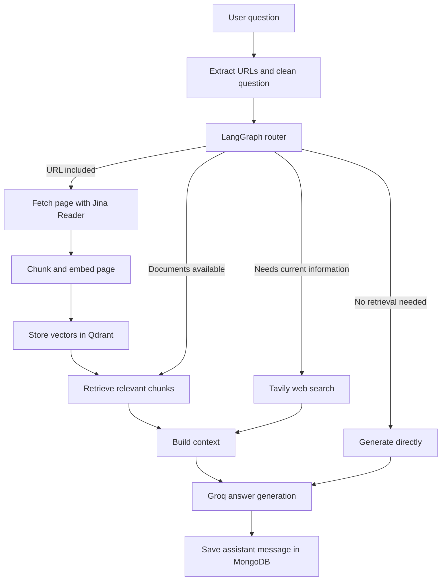
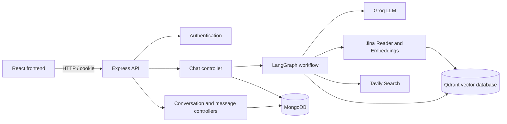

**Chat with your PDFs, ask questions about webpages, and bring in current information from the web.**

Xcraper is a full-stack AI research/chat application. Users can create conversations, upload PDF documents, include webpage URLs in questions, and ask questions using a LangGraph workflow that decides whether document retrieval and/or web search should be used.

The project is built with **React, TypeScript, Express, MongoDB, LangGraph, Groq, Jina AI, Qdrant, and Tavily**.

---

## Contents

- [Features](#features)
- [How it works](#how-it-works)
- [Architecture](#architecture)
- [Tech stack](#tech-stack)
- [Project structure](#project-structure)
- [Prerequisites](#prerequisites)
- [Environment variables](#environment-variables)
- [Getting started](#getting-started)
- [API overview](#api-overview)
- [Data model overview](#data-model-overview)

## Features

- **User authentication** — register, log in, retrieve the current user, and log out using cookie-based authentication.
- **Conversation management** — create conversations and retrieve a user's conversations.
- **PDF knowledge base** — upload a PDF in a conversation, extract its text, split it into overlapping chunks, generate embeddings, and store those vectors in Qdrant.
- **Chat with documents** — retrieve relevant chunks from the documents associated with a conversation and provide them to the language model as context.
- **Ask about webpages** — include one or more URLs in a question. Xcraper fetches readable page content through Jina Reader, indexes it, and retrieves relevant chunks.
- **Optional web search** — the LangGraph router checks whether a question needs up-to-date information. When required, Tavily search results are added to the model context.
- **Persistent chat history** — users' conversations, messages, documents, and message-to-document attachments are stored in MongoDB.
- **Streaming-ready graph** — the chat controller currently invokes the graph synchronously and returns the completed answer as JSON.

## How it works

### 1. PDF ingestion

1. The user uploads a PDF while creating a message.
2. The backend extracts text with `pdf-parse`.
3. Text is split with `RecursiveCharacterTextSplitter` using a chunk size of 500 characters and an overlap of 50 characters.
4. Jina Embeddings (`jina-embeddings-v3`) creates an embedding for each chunk.
5. The vectors and metadata are stored in the Qdrant `documents` collection.
6. MongoDB stores the document record and an attachment connecting that document to the message that uploaded it.

### 2. URL ingestion

When a user includes a URL in a chat question:

1. The URL is extracted from the question and removed from the natural-language question text.
2. Jina Reader (`https://r.jina.ai/`) fetches readable page content.
3. The content is chunked and embedded with Jina Embeddings.
4. A URL document is saved in MongoDB and its vectors are stored in Qdrant.
5. The graph retrieves relevant chunks from that document before generating the answer.

### 3. Question answering with LangGraph

The graph uses a router node to decide which information sources are needed:

- **RAG:** if the conversation has documents, retrieve relevant document chunks.
- **Web search:** if the model or keyword checks indicate that the question needs current information, search with Tavily.
- **Both:** retrieve document context and perform web search.
- **Direct answer:** if neither source is needed, generate an answer without external context.
- **URL path:** if the question contains URLs, index those pages and then retrieve from them.

The generation node combines the available document and web context with recent conversation messages and calls the Groq chat model.



## Architecture



## Tech stack

| Area | Technology |
|---|---|
| Frontend | React 19, TypeScript, Vite |
| Styling | Tailwind CSS 4 |
| Client state | Zustand |
| HTTP client | Axios |
| Routing | React Router 7 |
| Markdown rendering | React Markdown, remark-gfm |
| Backend | Node.js, Express 5, TypeScript |
| Database | MongoDB with Mongoose |
| Authentication | JWT, bcrypt, HTTP cookies |
| AI orchestration | LangGraph and LangChain |
| Chat model | Groq (`openai/gpt-oss-120b`) |
| Embeddings | Jina AI (`jina-embeddings-v3`) |
| Vector database | Qdrant |
| Web search | Tavily |
| PDF parsing | pdf-parse |

## Project structure

```text
xcraper/
├── backend/
│   ├── src/
│   │   ├── config/          # Database, environment, Groq, Qdrant, Jina/Tavily setup
│   │   ├── controllers/     # Auth, chat, conversation, message and upload handlers
│   │   ├── graph/           # LangGraph state, nodes and graph definition
│   │   ├── middlewares/     # Authentication middleware
│   │   ├── models/          # Mongoose models
│   │   ├── rag/             # Text chunking
│   │   ├── routes/          # Express routes
│   │   ├── schemas/         # Request/file schemas
│   │   ├── services/        # LLM, embeddings, retrieval, PDF, URL and vector services
│   │   └── server.ts        # Express application entry point
│   ├── package.json
│   └── tsconfig.json
│
└── frontend/
    ├── src/
    │   ├── components/      # Navbar, sidebar, route guards and UI components
    │   ├── config/          # Axios API client
    │   ├── hook/            # Chat hook
    │   ├── pages/           # Home, login, register and chat pages
    │   ├── store/           # Zustand auth, conversation and message stores
    │   └── types/           # Frontend TypeScript types
    ├── package.json
    └── vite.config.ts
```

## Prerequisites

Before running Xcraper, install or create:

- Node.js (a current LTS release is recommended)
- npm
- A MongoDB database (local MongoDB or MongoDB Atlas)
- A Qdrant instance (Qdrant Cloud or self-hosted)
- API credentials for Groq, Jina AI, and Tavily

## Environment variables

Create a `.env` file inside the `backend/` directory.

| Variable | Description |
|---|---|
| `PORT` | Backend port. Defaults to `3000`. |
| `MONGO_URI` | MongoDB connection URI. |
| `JWT_SECRET` | Secret used to sign authentication JWTs; must be at least 32 characters. |
| `FRONTEND_URL` | Exact frontend origin allowed by CORS, including protocol. |
| `GROQ_API_KEY` | Groq API key. |
| `JINA_API_KEY` | Jina AI API key. |
| `JINA_ENDPOINT` | Jina embeddings API endpoint used by the backend. |
| `QDRANT_CLUSTER_ENPOINT` | Qdrant cluster URL. Keep this spelling exact; it is the variable name currently used in the code. |
| `QDRANT_API_KEY` | Qdrant API key. |
| `TAVILY_API_KEY` | Tavily API key. |
| `NODE_ENV` | `development` or `production`; defaults to `development`. |

Create a `.env` file inside `frontend/`:

```env
VITE_SERVER_URL=http://localhost:3000
```

The frontend Axios client appends `/api` to `VITE_SERVER_URL` and sends credentials with requests.

> Keep real API keys, database credentials, and JWT secrets out of Git. Do not commit either `.env` file.

## Getting started

### 1. Clone the repository

```bash
git clone https://github.com/T-Lak23/xcraper.git
cd xcraper
```

### 2. Configure the backend

```bash
cd backend
npm install
```

Create `backend/.env` and fill in the variables listed above.

Start the backend in development mode:

```bash
npm run dev
```

The API defaults to:

```text
http://localhost:3000
```

The root health endpoint is:

```text
GET http://localhost:3000/
```

### 3. Configure the frontend

Open a second terminal:

```bash
cd xcraper/frontend
npm install
```

Create `frontend/.env`:

```env
VITE_SERVER_URL=http://localhost:3000
```

Start the Vite development server:

```bash
npm run dev
```

Open the local URL printed by Vite in your terminal.

### Production build commands

Backend:

```bash
cd backend
npm run build
npm start
```

Frontend:

```bash
cd frontend
npm run build
npm run preview
```

## API overview

All application API routes are mounted under `/api`. Routes marked **Protected** require the authentication cookie.

| Method | Endpoint | Access | Purpose |
|---|---|---|---|
| `POST` | `/api/auth/register` | Public | Register a user |
| `POST` | `/api/auth/login` | Public | Log in |
| `POST` | `/api/auth/logout` | Protected | Log out |
| `GET` | `/api/auth/me` | Protected | Get the current user |
| `POST` | `/api/conversations` | Protected | Create a conversation |
| `GET` | `/api/conversations` | Protected | List the user's conversations |
| `POST` | `/api/messages/:conversationId/messages` | Protected | Create a message; accepts an optional PDF upload in the `pdf` multipart field |
| `GET` | `/api/messages/:conversationId/messages` | Protected | Get conversation messages and their attachments |
| `GET` | `/api/messages/:conversationId/messages/documents` | Protected | List documents associated with a conversation |
| `POST` | `/api/chat` | Protected | Ask a question and receive the completed assistant message |

### Chat request example

```json
{
  "query": "Summarize the main ideas in the uploaded document.",
  "conversationId": "YOUR_CONVERSATION_ID"
}
```

The chat endpoint returns a JSON response containing the saved assistant `message`. It is not currently implemented as an SSE streaming response.

## Data model overview

MongoDB stores the application's users and chat data:

- **User** — account identity and authentication information.
- **Conversation** — belongs to a user and contains that user's chat history.
- **Message** — belongs to a conversation and stores the message content and role (`human` or `ai`).
- **Document** — represents an indexed PDF or URL and belongs to a conversation.
- **MessageAttachment** — links a specific message to the document uploaded with that message.

Qdrant stores the embedded text chunks. Each point includes payload metadata such as `documentId`, source, source type, chunk index, and text. Retrieval filters by the document IDs belonging to the conversation.

